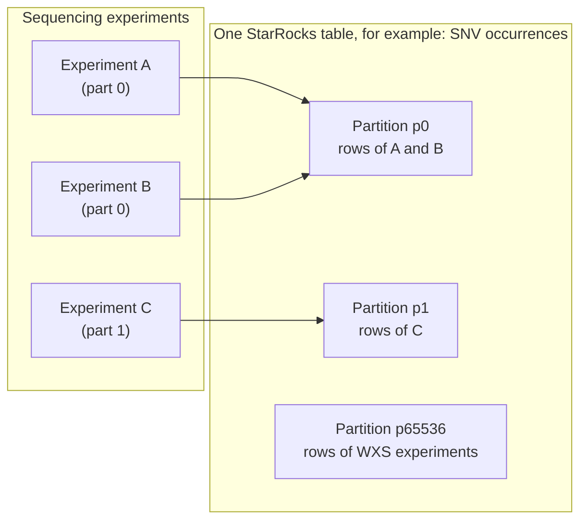
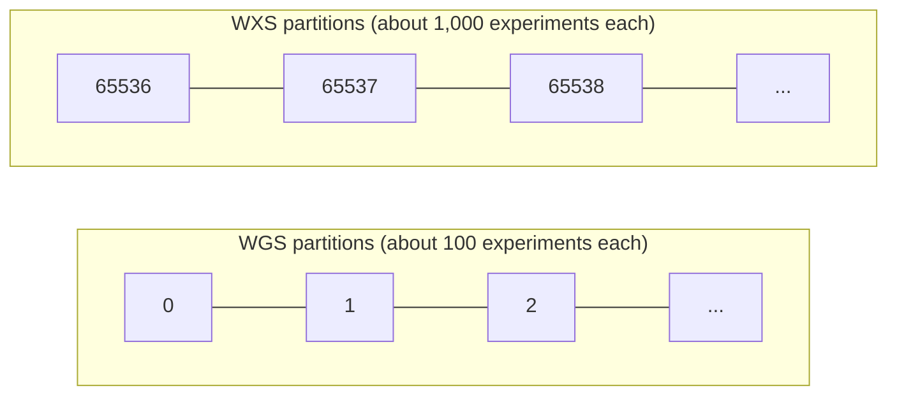
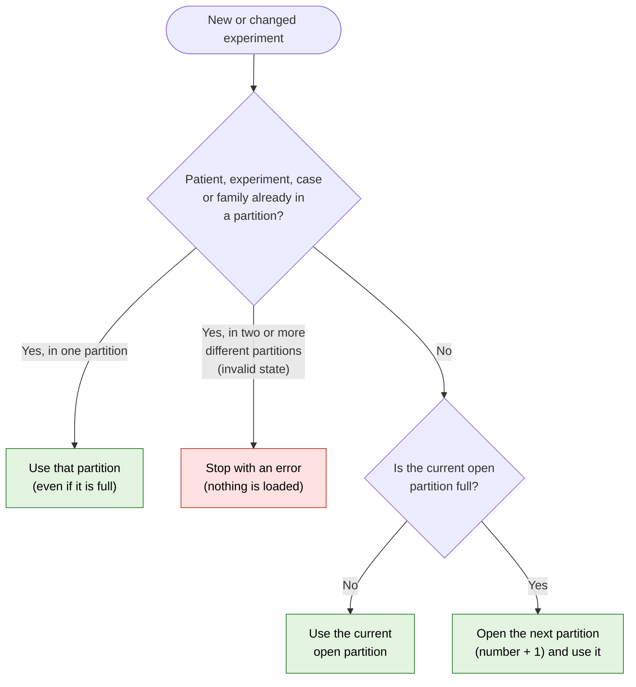
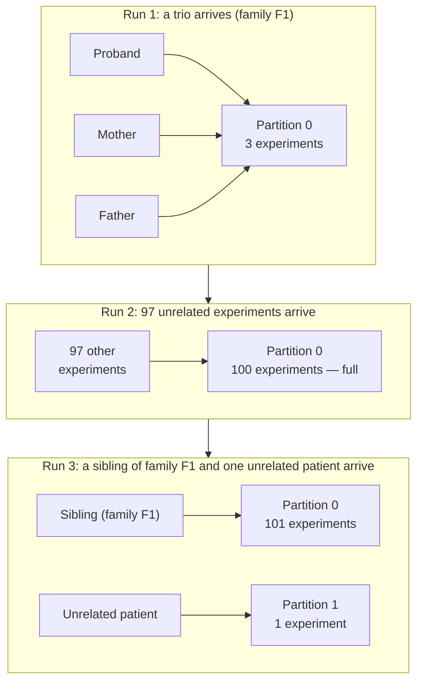
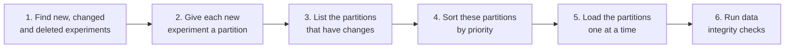
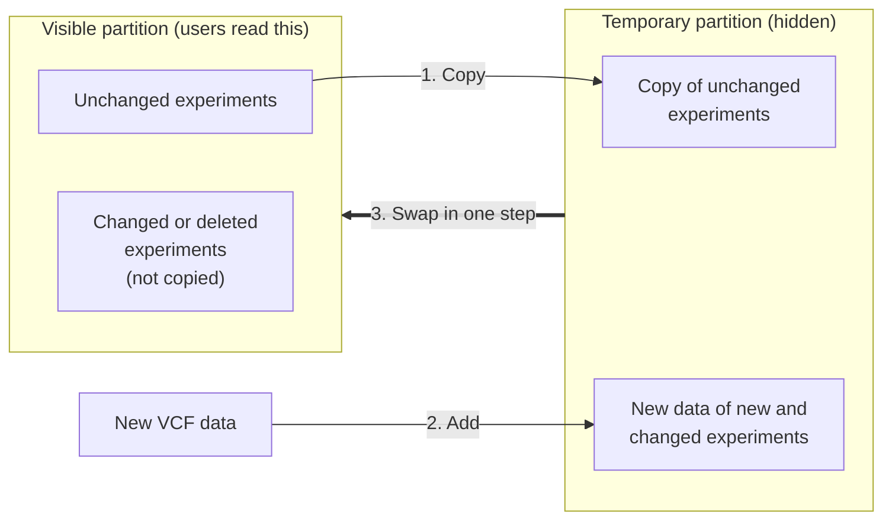
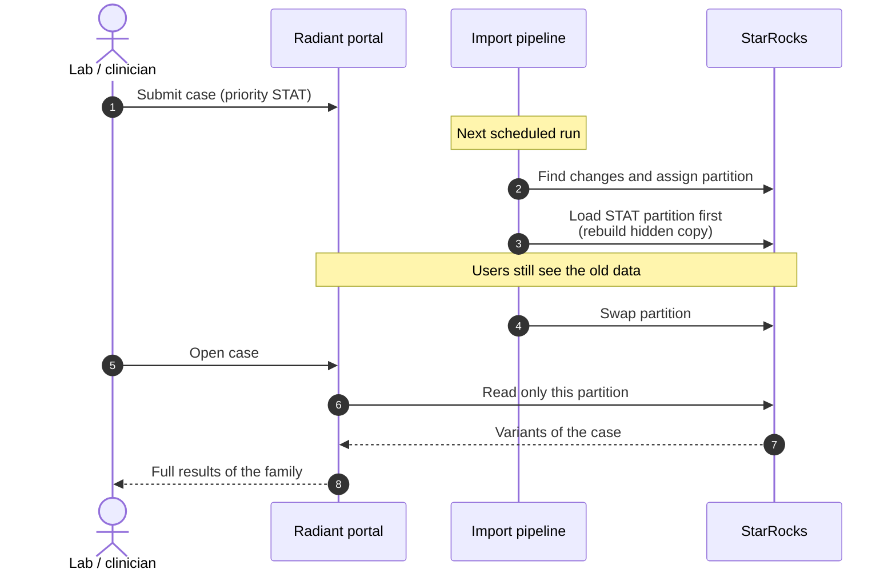

# Data Partitioning

:::tip[Summary]
- A **partition** is a numbered group of sequencing experiments. The pipeline loads, replaces and reads the data of one group at a time.
- **WGS and WXS use different partitions.** A WGS partition holds about 100 experiments. A WXS partition holds about 1,000.
- **Related experiments stay together.** Experiments that share a patient, a sequencing experiment, a case or a family always go into the same partition.
- **Each table changes in one step.** In each table, the data of a partition becomes visible in one step, after the new copy is fully loaded. The pipeline swaps the tables one after the other. Thus, during an import, a case can show new data in one table and old data in another table for a short time.
:::

## What is a partition?

Each sequencing experiment gets a partition number: the `part` column of `staging_sequencing_experiment`. The experiment keeps this number for its full life.

The large tables in StarRocks are split on a `part` column (`PARTITION BY (part)`). There are two kinds.

**Experiment tables.** One row belongs to one experiment. All the rows of an experiment are in the partition that has its `part` number.

| Table | Content | Database |
|:--|:--|:--|
| `germline__snv__occurrence`, `somatic__snv__occurrence` | SNV occurrences | Tenant |
| `germline__cnv__occurrence`, `somatic__cnv__occurrence` | CNV occurrences | Tenant |
| `exomiser` | Exomiser results | Tenant |
| `raw_exomiser` | Exomiser results before they are loaded into `exomiser` | Shared |

**Variant tables.** One row belongs to one variant. A partition holds the variants that occur in the experiments of that partition. Thus, one variant can be in many partitions.

| Table | Content | Database |
|:--|:--|:--|
| `germline__snv__staging_variant_frequency_part`, `somatic__snv__staging_variant_frequency_part` | Variant frequencies counted on one partition. Also split on `tenant_code`. | Shared |
| `snv__consequence_filter_partitioned` | Consequence filter rows, for the experiments of all tenants | Shared |
| `snv__variant_partitioned` | Variants. **Its `part` is a group of 10 partitions:** the experiment `part` divided by 10 (partitions 0 to 9 give 0, partitions 10 to 19 give 1). | Tenant |

For example, experiment 42 has `part = 3`. Its SNVs are in partition 3 of `germline__snv__occurrence`. Its CNVs are in partition 3 of `germline__cnv__occurrence`. Its Exomiser results are in partition 3 of `exomiser`.

Thus, "partition 0" means partition 0 of each of these tables, together (except `snv__variant_partitioned`, which uses groups of 10).

### Partitions and tenants

All tenants use the same partition numbers. One partition can hold experiments of more than one tenant. The **Database** column in the tables above tells where the rows of each table are:

- **Tenant tables** have one copy in the database of each tenant. Thus, the rows of one tenant are always in the database of that tenant. The pipeline loads these tables one tenant at a time, for each tenant that has changes.
- **Shared tables** have one copy for all tenants. They are loaded in different ways:
  - `raw_exomiser` is loaded in one step for all the tenants of the run.
  - The frequency tables (`*__snv__staging_variant_frequency_part`) are also split on `tenant_code`. The pipeline loads them one tenant at a time.
  - `snv__consequence_filter_partitioned` is loaded in one step for **all** tenants of the platform, also the tenants that have no changes in the run.

### Why do we use partitions?

Genomic data is very large. One whole-genome VCF file can contain millions of variants. It is not practical to process all the data of all patients in one step each time a new case arrives. Partitions give three benefits:

| Benefit | What it means |
|:--|:--|
| **Small units of work** | The pipeline processes one partition at a time, not all the data. |
| **Safe updates** | The pipeline rebuilds one partition and replaces it in one step. Other partitions do not change. |
| **Fast reads** | When the portal shows the variants of one experiment, the database reads only one partition. |

## Two kinds of partitions: WGS and WXS

The pipeline uses the **experimental strategy** of an experiment to select the kind of partition:

| Strategy | First partition number | Approximate size of one partition |
|:--|:--|:--|
| **WGS** (whole genome) | `0` | 100 experiments |
| **WXS** (whole exome) | `65536` (hex `0x00010000`) | 1,000 experiments |

A whole genome contains much more variant data than an exome. For this reason, a WGS partition holds fewer experiments than a WXS partition. The two kinds of partitions use separate number ranges, so they never mix:

:::note
The grouping rules below apply **inside one strategy only**. If a patient has a WGS experiment and a WXS experiment, the WGS experiment goes into a WGS partition and the WXS experiment goes into a WXS partition.
:::

## How experiments are grouped

### The main rule: related experiments stay together

When a new experiment arrives, the pipeline examines four identifiers:

1. The **patient**
2. The **sequencing experiment**
3. The **case**
4. The **family**

If one of these identifiers is already in a partition (for the same strategy), the new experiment goes into **that** partition. This keeps a full patient history, a full case and a full family in one partition.

If none of these identifiers is in a partition, the experiment goes into the **current open partition**. When the open partition is full, the pipeline opens a new partition with the next number.

### The size limit is a soft limit

The limit (100 for WGS, 1,000 for WXS) is a **target**, not a hard maximum. The limit only tells the pipeline when to open a new partition for **unrelated** experiments. A related experiment always joins its group, even when that partition is already full. So, an old partition can grow above the limit over time.

:::info[Why a soft limit?]
To keep a family together is more important than to keep partitions at an exact size. If a family were split across two partitions, the analysis of that family (for example, parental origin and transmission) would need data from two partitions.
:::

### Example: a trio and its sibling

The example below uses WGS, where a partition holds about 100 experiments.

- In run 3, the sibling goes into partition 0 because family F1 is already there. Partition 0 is full, but this does not matter for a related experiment.
- The unrelated patient has no link to an existing partition, and partition 0 is full. Thus, the pipeline opens partition 1.

### Invalid state: identifiers in two partitions

The identifiers of one experiment must always point to **one** partition. If they point to two different partitions (for example, the patient is in partition 3 but the family is in partition 5), the data is in an **invalid state**. This must not occur.

The pipeline checks for this state. If it finds it, it stops the full import run with an error and loads nothing. Thus, the data of one group is never split. An operator must correct the data before the next run.

## How a partition is loaded

### The import run

The import has no schedule of its own. The *Case Scheduler* starts it, and the Case Scheduler runs one time each day. Each import run does these steps:

Step 6 runs a test suite on the StarRocks data of the tenants that the run changed. If a test fails, the run fails.

- **Only changes are processed.** A partition that has no new, changed or deleted experiment is not touched.
- **One partition at a time.** The pipeline loads only one partition at a time. A lock makes sure that two loads never run at the same time.

### Priority order

Each experiment has a request priority. The priority of a partition is the **most urgent** priority of the experiments inside it that have changes. The pipeline loads the most urgent partitions first.

| Order | Request priority |
|:--|:--|
| 1 (first) | **STAT** |
| 2 | **ASAP** |
| 3 | **URGENT** |
| 4 (last) | **ROUTINE** (also used when no priority is given, or when the priority has an unknown value) |

Example:

| Partition | Experiments with changes | Partition priority | Load order |
|:--|:--|:--|:--|
| 4 | 2 × ROUTINE | ROUTINE | 3rd |
| 7 | 1 × ROUTINE, 1 × **STAT** | STAT | **1st** |
| 65540 | 5 × URGENT | URGENT | 2nd |

### Rebuild, then swap

The pipeline never edits a visible partition row by row. For each table, it builds a full new copy of the partition in a hidden, temporary area. Then, it replaces the visible partition with the new copy in one step.

The pipeline builds the new copy in one of two ways:

| Method | Tables | How |
|:--|:--|:--|
| **Copy and add** | Experiment tables | Keep the rows of unchanged experiments, add the rows of new and changed experiments. See the steps below. |
| **Full rebuild** | Variant tables | Compute the full partition again from the experiment tables, with `INSERT OVERWRITE`. No old row is copied. |

For the experiment tables:

1. **Copy** the rows of all unchanged experiments of the partition into the temporary partition.
2. **Add** the rows of the new and changed experiments. Deleted experiments are not added.
3. **Swap.** The temporary partition replaces the visible partition in one step (StarRocks [temporary partitions](https://docs.starrocks.io/docs/table_design/data_distribution/Temporary_partition/)).

For the variant tables, StarRocks does the same swap. [`INSERT OVERWRITE`](https://docs.starrocks.io/docs/loading/InsertInto/) writes the new rows into temporary partitions, then swaps them with the original partitions. The pipeline sets `dynamic_overwrite = true`, so only the partitions that receive new rows are replaced. The other partitions do not change.

Until the swap, users continue to see the old data of that table. After the swap, users see the new data. In one table, there is no time when users see a mix of old and new rows.

:::caution[The tables are swapped one at a time]
The pipeline swaps each table in a separate step, and it does this for one tenant at a time. The order is:

1. Exomiser results
2. SNV occurrences (germline, then somatic)
3. CNV occurrences (germline, then somatic)

Between two swaps, a case can show new data in one table and old data in another table. For example, the SNVs of a case can be new while its CNVs are still old. The case is consistent again after the last swap of the partition load.
:::

## How partitioning affects the user experience

| What the user sees | Why |
|:--|:--|
| **All members of a family appear in the portal at the same time.** | The family is in one partition. The partition becomes visible in one step. |
| **One table of a case is never shown half loaded.** | Each table is rebuilt in a hidden partition and swapped in one step. |
| **During an import, a case can show new data in one table and old data in another table for a short time.** | The pipeline swaps the tables one after the other, not all together. |
| **A STAT case is available sooner than a ROUTINE case.** | The partition that holds a STAT case is loaded first. |
| **A ROUTINE case can be available early, by chance.** | If a ROUTINE case shares a partition with a STAT case, it is loaded with the STAT case. |
| **A new family member can take longer to appear than a new unrelated patient.** | The new member joins the old family partition. The pipeline must rebuild that full partition, which can be larger than the limit. |
| **Data in an invalid state stops all new data.** | If the identifiers of an experiment point to two partitions, the full import run stops. No partition is loaded until an operator corrects the data. |
| **The variant table of one case opens quickly.** | The portal first finds the partition number of the experiment. Then it reads only that partition, not all the data. |
| **Variant frequencies change after each import.** | Germline and somatic SNV frequencies are counted for each partition, then added together across all partitions of the tenant. Each partition load updates the totals of that tenant. |
| **A deleted experiment disappears after the next import.** | The next rebuild of its partition does not copy its rows. |

## Glossary

| Term | Meaning |
|:--|:--|
| **Partition** (`part`) | A numbered group of sequencing experiments that are loaded, replaced and read together. |
| **Sequencing experiment** | One sequencing run of one sample (WGS or WXS). This is the unit that is put in a partition. |
| **Experimental strategy** | WGS (whole genome) or WXS (whole exome). It selects the kind of partition. |
| **Open partition** | The partition that receives new unrelated experiments until it is full. |
| **Soft limit** | The target size of a partition. Related experiments can go above it. |
| **Delta** | The experiments that are new, changed or deleted since the last import. |
| **Swap** | The one-step replacement of a visible partition by its rebuilt copy. |

## For more information

These links are for readers who want to see the implementation:

- Table definitions (`PARTITION BY`): [`radiant/dags/sql/radiant/init/`](https://github.com/radiant-network/radiant-portal-pipeline/tree/main/radiant/dags/sql/radiant/init); tenant and shared table names: [`radiant/tasks/data/radiant_tables.py`](https://github.com/radiant-network/radiant-portal-pipeline/blob/main/radiant/tasks/data/radiant_tables.py)
- Partition assignment rules: [`radiant/tasks/starrocks/partition.py`](https://github.com/radiant-network/radiant-portal-pipeline/blob/main/radiant/tasks/starrocks/partition.py)
- Daily start of the import: [`radiant/dags/case_scheduler.py`](https://github.com/radiant-network/radiant-portal-pipeline/blob/main/radiant/dags/case_scheduler.py)
- Detection of new and changed experiments: [`staging_sequencing_experiment_delta_create_table.sql`](https://github.com/radiant-network/radiant-portal-pipeline/blob/main/radiant/dags/sql/radiant/init/staging_sequencing_experiment_delta_create_table.sql)
- Import run (assign, sort, trigger): [`radiant/dags/import_radiant.py`](https://github.com/radiant-network/radiant-portal-pipeline/blob/main/radiant/dags/import_radiant.py)
- Data integrity checks: [`radiant/dags/data_integrity_starrocks.py`](https://github.com/radiant-network/radiant-portal-pipeline/blob/main/radiant/dags/data_integrity_starrocks.py)
- Load of one partition (rebuild and swap): [`radiant/dags/import_part.py`](https://github.com/radiant-network/radiant-portal-pipeline/blob/main/radiant/dags/import_part.py)
- Frequencies of each partition, then of the tenant: [`germline_snv_staging_variant_freq_insert.sql`](https://github.com/radiant-network/radiant-portal-pipeline/blob/main/radiant/dags/sql/radiant/germline_snv_staging_variant_freq_insert.sql), [`germline_snv_variant_frequency_insert.sql`](https://github.com/radiant-network/radiant-portal-pipeline/blob/main/radiant/dags/sql/radiant/germline_snv_variant_frequency_insert.sql)
- Pipeline notes: [`docs/RADIANT.md`](https://github.com/radiant-network/radiant-portal-pipeline/blob/main/docs/RADIANT.md)
