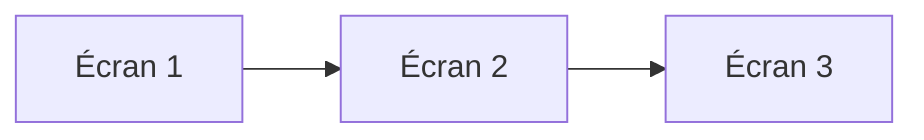

# Nom du concept

Définition en une ou deux phrases, avec les mots de l'interface.

## À quoi ça sert {/* #what-it-is-for */}

Les situations où l'utilisateur s'en sert, du point de vue de son travail.

{/* Facultatif : vue d'ensemble d'un enchaînement d'écrans. */}

## Voir aussi {/* #see-also */}

- [Procédure qui utilise ce concept](./procedure.md)
- [Référence associée](./reference.md)
