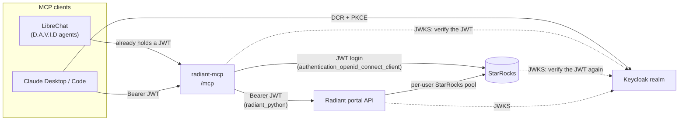
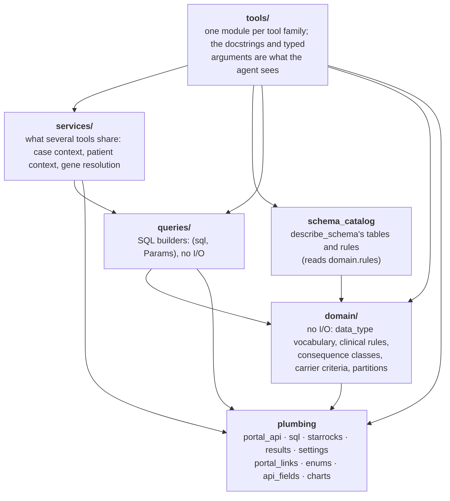
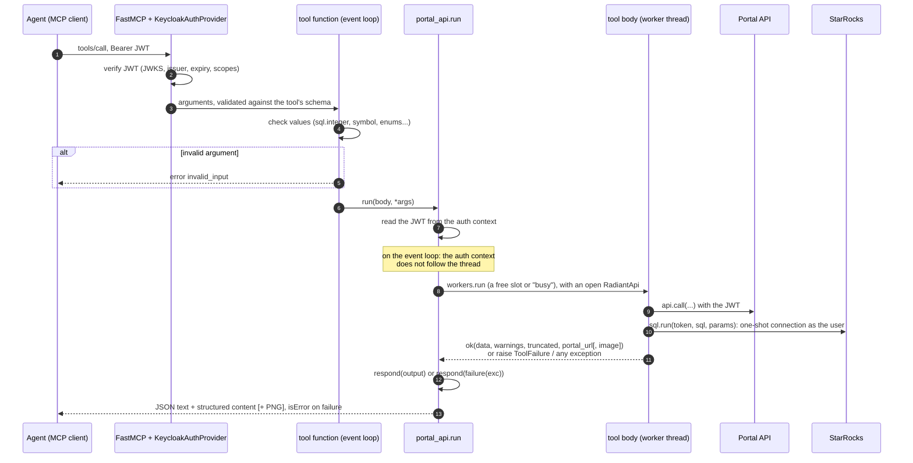
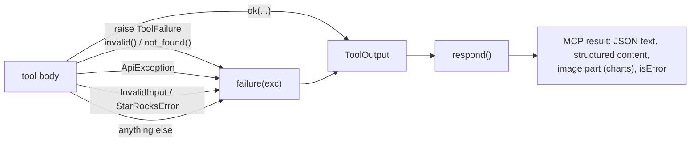
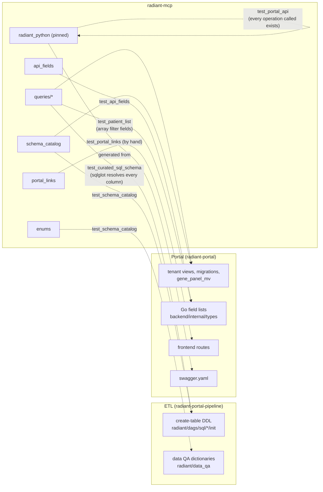

# Developer guide

How radiant-mcp is put together, and what to touch when you change it. `CLAUDE.md`
lists every module and its gotchas; this page shows how they fit.

## The system around the server

The server holds no credential. Every call runs as the user who made it: the
Keycloak JWT the client presents is forwarded to the portal API and to StarRocks,
which each check it and apply that user's own rights.



- **Clients.** LibreChat already has the user's Keycloak token and sends it as a
  Bearer. Claude Desktop finds the realm through `/.well-known/oauth-protected-resource`
  (`oauth.py`), registers with Keycloak (DCR) and runs the PKCE flow against it.
  Both end with the same kind of JWT.
- **The server** (`__main__.py`, `app.py`) mounts the FastMCP app at `/mcp`, adds
  `/health`, `/ready` and the protected-resource metadata, and verifies every
  request with fastmcp's `KeycloakAuthProvider`: signature against the realm's
  JWKS, issuer, expiry, `OAUTH_REQUIRED_SCOPES`.
- **The portal API** receives the same JWT (`portal_api.connect`) and applies its
  per-user and per-organization rules. Its `swagger.yaml` is the contract; the
  client is the generated `radiant_python`, pinned to a portal commit in
  `pyproject.toml`.
- **StarRocks** receives the same JWT through the `authentication_openid_connect_client`
  plugin (`starrocks.connect`), verifies it again and runs the statement as the
  StarRocks user named after the token's `sub`. There is no pool, no service
  account and no fallback: a call without a JWT never connects.

## Layers



A module imports only from the layers below it, and a tool module never imports
another tool module: what two tools share goes to `services/` (I/O) or `domain/`
(no I/O). The rule is a convention, not checked by a test.

- **plumbing**
  - `portal_api.run` runs a tool body for the caller;
  - `sql` validates inputs and binds parameters;
  - `starrocks` opens the JWT connection;
  - `results` holds the result envelope;
  - `settings` holds the configuration;
  - `charts` draws (matplotlib, no I/O).
- **domain**: the values the rules are written with. `data_types` is the single
  vocabulary of `data_type` (`Literal` types, so the agent sees the allowed
  values), and `rules` holds the definitions that `second_hit` and the cohort
  tools quote back in their results.
- **queries**: every curated statement, as a function returning `(sql, Params)`.
  Values are always bound (`Params`), names go through `sql.tenant_db()` /
  `sql.shared_db()`, and every occurrence query filters on the `part` of its
  key.
- **services**: `case_context` (the case, its sequencings and the occurrence
  keys with their `part`), `patient_context` (the patient page sections) and
  `resolve_gene`.
- **tools**: argument checks, then one call to `portal_api.run` (or
  `tools/query._run` for the raw SQL tools) with a synchronous body.

## A tool call



- **Validation.** fastmcp checks the types from the signature (including pydantic
  models such as survival's `GroupSpec`). The tool function then checks the
  values that reach SQL: integers, gene symbols, HPO ids, enum values
  (`enums.canonical_values` maps them to their stored spelling).
  A value fastmcp rejects (a `Literal` outside its list, a `GroupSpec` rule)
  never reaches the tool: `results.ArgumentErrors`, a middleware that
  `register_tools` installs, turns it into the envelope (`invalid_input`, one
  `details.errors` entry per argument, `details.allowed` for a closed list).
  `tests/unit/test_tool_calls.py` calls tools through a FastMCP `Client` to
  check what clients get.
- **Threads.** `radiant_python` and `mysql.connector` are synchronous, so the body
  runs on a worker thread. The JWT is read before the hop and passed down
  explicitly: `get_jwt_token()` returns nothing on the worker thread.
- **Capacity.** The worker threads are shared by every user: `workers.run` admits at most
  `MCP_MAX_CONCURRENT_CALLS` bodies at once, and a call that finds no free slot
  within `MCP_QUEUE_TIMEOUT` fails with `upstream` instead of waiting behind slow
  ones. The cap counts tool calls, not connections: `gene_info`, `variant_details`,
  `get_patient_context`, the task lookups of `case_context` and the `cohort_carriers`
  summaries run up to 3 statements
  or portal requests side by side inside their slot, so 20 calls can hold up to
  60 StarRocks connections or portal requests at once.
- **Partial failures.** A section that fails does not fail the tool: case
  context data types, patient page sections, variant sections and gene
  annotations are each caught and reported in `warnings` (`results.describe`).
  An expired token or a portal 401 is the exception: `describe` raises it again,
  so the call fails with `auth_required` instead of answering `ok` with empty
  sections.
- **Charts.** The body draws with `charts`, which renders one figure at a time
  (`_RENDER_LOCK`), and returns `ok(data, image=png)`.

## The result envelope

Every tool returns the same object (`results.ToolOutput`). It goes out as the JSON
text the agent reads, as structured content, and as every tool's output schema.

```json
{
  "ok": true,
  "data": {"...": "the tool's own fields, described in its docstring"},
  "warnings": ["always a list: what the answer may be missing"],
  "truncated": {"reason": "what was cut and how to narrow", "lists": ["which lists"]},
  "portal_url": "the portal page of the main entity"
}
```



`failure()` maps each exception to one code:

- `ToolFailure`: the code it carries, such as `not_found`, `ambiguous_tenant`
  (with `details.tenants`) or `unavailable` (a tenant without clinical data).
- `starrocks.StarRocksError`: `forbidden` when StarRocks denies access,
  `auth_required` when the caller's token expired during the call (`starrocks.connect`
  checks `exp` before each connection), otherwise `upstream`, with the StarRocks message. `read_query` turns a statement StarRocks
  cannot parse or analyse (`kind == "invalid"`) into `invalid_input`, and so does
  `table_overview` for an unknown table: the agent wrote it and must fix it, not
  retry it. An unknown database is reported at connect and is `invalid` too.
- `sql.InvalidInput`: `invalid_input`; `one_of` / `all_of` put the accepted values
  in `details.allowed`.
- `ApiException`: by status. 400 and 422 give `invalid_input`, 401
  `auth_required`, 403 `forbidden` and 404 `not_found`; any other status gives
  `upstream`. `details` keeps the `status`, the `correlation_id` and, for a 4xx,
  the response `body`. A 5xx body is logged, not returned: it can carry the
  portal's internals. Status 0 is the generated client's own error: an
  `SSLError` reason (a TLS failure) gives `upstream`: its text is logged, not
  returned; any other (the client could not build the request) gives `internal`.
- Anything else: `internal`. The exception is logged with its traceback, and the
  agent gets only its type, since the message can name internal hosts.

The same format is sent as MCP server instructions at initialize
(`results.INSTRUCTIONS`) and described in the agent prompts
(`librechat-local/agent-radiant-*.md`). `tests/unit/test_results.py` checks the
contract.

## Configuration

Every environment variable is a field of `settings.Settings` (pydantic-settings).
`__main__` calls `load_or_exit()` first, so a missing `KEYCLOAK_REALM_URL` or a
malformed value stops the server with one line per variable. Modules call
`get_settings()`, never `os.getenv`. The variables and their defaults are listed
in the README.

The StarRocks connection is always TLS, because StarRocks requires it for JWT
logins. `STARROCKS_SSL_VERIFY=true` also checks the FE certificate, against
`STARROCKS_SSL_CA` for a private CA (QA and prod: the CA generated in
`qlin-*-infra/terraform/secrets`) or against the system CA bundle. Leave it off
only for the local stack: without it, anything on the path can read the JWT the
server forwards.

## Contracts with the other modules

The server reads what the ETL and the portal own. The unit tests read their
checkouts, so a change on their side fails here instead of in production.



- **SQL** (`tests/unit/test_curated_sql_schema.py`). Every builder of `queries/`
  is called with sample arguments covering its branches. sqlglot then parses the
  statement and resolves each table and column against the ETL's DDL and the
  objects the portal creates in each tenant database (`schema_sources.py`).
  `test_query_params.py` checks that each statement binds exactly its
  placeholders and writes no literal value.
- **`describe_schema`** (`test_schema_catalog.py`). Every table and column of the
  catalog must exist, and every enum must match an ETL data QA dictionary.
- **Portal search fields** (`test_api_fields.py`). The fields the tools let the
  agent filter and sort on must match `CanBeFiltered` / `CanBeSorted` of the
  backend's Go field lists.
- **Patient list** (`test_patient_list.py`). `survival_curve` reads
  `v_pcx_30_patient_list` itself (`queries/patients.py`), mirroring the portal's
  `search_patients`: the array filter fields must be the portal's `IsArray`
  ones, and the schema check resolves every filter field in the query. It reads
  the view directly, so the portal's gates on its patient routes
  (`can_search_case`, `PATIENT_VIEW_ENABLED`) do not apply: the view masks the PHI
  columns by the caller's rights but filters no row, as for `read_query`. A Ranger
  policy on the `v_pcx_*` views is the place to restrict it.
- **Portal links** (`portal_links.py`). They mirror the frontend routes and the
  case variants tab parameters. No checkout checks them: update the module and
  its tests when the portal renames a route.
- **Portal API client.** `radiant_python` is installed from a portal commit;
  bumping that commit can rename models or methods. `test_portal_api.py` checks
  that every operation the code calls exists in the pinned client.

These checks read names (tables, columns, fields, operations), not meaning. The
rules copied from the other modules have no test and must be kept equal by hand
when their owner changes them:

- the germline and somatic carrier rules (`queries/quality.py`, thresholds in
  `domain/rules.py`): `qualifies` in the ETL's
  `germline_snv_staging_variant_freq_insert.sql` and
  `somatic_snv_staging_variant_freq_insert.sql`;
- the age groups of the patient list (`queries/patients.py`):
  `ageAtInitialDxGroupSQL` in the portal's `pcx_patients.go`;
- the filter semantics of the patient list (`IN`, `arrays_overlap` for an
  array field): the portal's `types/filter.go`;
- the portal links (`portal_links.py`): the frontend routes, above.

CI (`.github/workflows/test.yml`) checks out the ETL and portal `main` branches
next to the repo and requires both (`RADIANT_REQUIRE_ETL=1`,
`RADIANT_REQUIRE_PORTAL=1`). It checks out **only some paths** (`sparse-checkout`):
the ETL's `radiant/dags/sql`, `radiant/data_qa/macros` and `radiant_tables.py`;
the portal's view scripts, migrations, `backend/internal/types` and
`starrocks_tenant.go`. A test that reads another file passes locally and fails
in CI: add the path to the workflow in the same change.

Locally, point `RADIANT_ETL_DIR` and `RADIANT_PORTAL_DIR` at checkouts on
`main`; without them those tests are skipped. A checkout on another branch gives
false failures; an archive of `main` avoids touching it:
`git -C ../radiant-portal archive origin/main | tar -x -C /tmp/portal-main`.

## Adding a tool

1. Pick the module in `tools/`, or add one. Write the async tool function with
   typed arguments (`Literal` from `domain.data_types` for a `data_type`) and a
   docstring: the docstring is the documentation the agent gets, so say what the
   fields of `data` mean and when to prefer this tool. FastMCP publishes only the
   text before `Args:` and one description per argument entry: put the whole
   explanation above `Args:` and give each argument its own line
   (`test_registration.py` checks it).
2. Check the arguments, and return `respond(error("invalid_input", ...))` for a
   bad value before any call.
3. Write the body as a synchronous function `(api, token, *args) -> ToolOutput`.
   Return `ok(data, warnings=..., truncated=..., portal_url=...)`, raise
   `invalid()` / `not_found()`, and let the API and StarRocks errors propagate.
4. Put new SQL in `queries/` as `(sql, Params)`, bind every value, filter
   occurrences on `part`, and add the builder to `_queries()` of
   `test_curated_sql_schema.py`, with arguments that cover its branches:
   `test_every_builder_is_covered` fails until it is there, whatever its module,
   and `test_query_params.py` checks the same list for placeholders and literals.
5. Register the function in `tools/__init__.py`: `API_TOOLS` when it needs the
   portal API, the always-on list otherwise. Update `test_registration.py` and
   the tool count in `test_results.py`.
6. Test the body with the `fake_api`, `fake_sql` and `run` fixtures
   (`tests/unit/conftest.py`). `run` returns the envelope, and its `png` attribute
   holds a chart's image.
7. List the tool in the README and `CLAUDE.md`, explain it in plain words in
   `docs/tools.md` (a test checks every tool has an entry), and tell the agents
   when to use it in `librechat-local/agent-radiant-*.md`. The QA LibreChat config
   (`qlin-qa-infra`, `kubernetes-manifests/apps/librechat/librechat.yaml`) holds a
   copy of these prompts: sync it in the same release.

## Running it

- Unit tests: `RADIANT_ETL_DIR=../radiant-portal-pipeline RADIANT_PORTAL_DIR=../radiant-portal uv run pytest`
- Lint: `uv run ruff check .`
- Full stack (Keycloak, StarRocks, the server):
  - start it with `docker compose up --build`;
  - run the integration test with `docker compose --profile test run --rm test-runner`.
- A local LibreChat with the agents: `librechat-local/README.md`.
